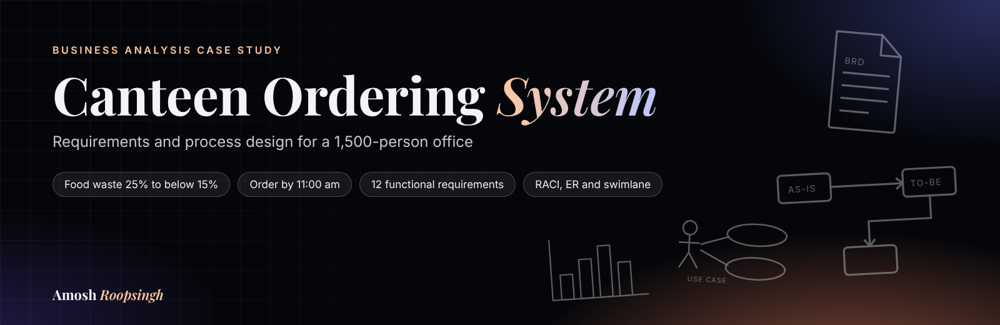
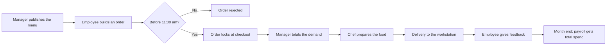
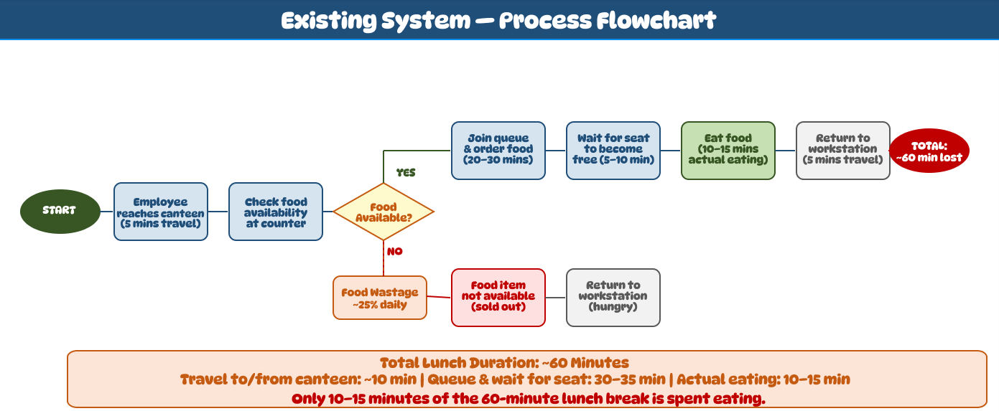
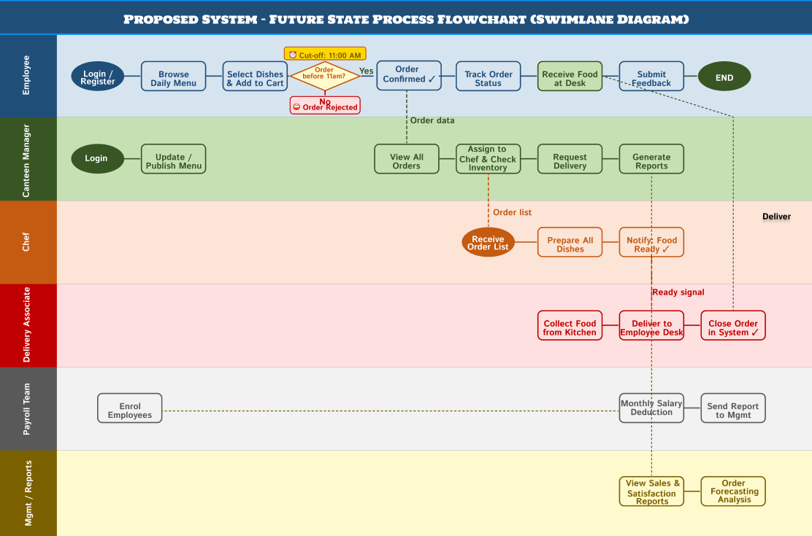
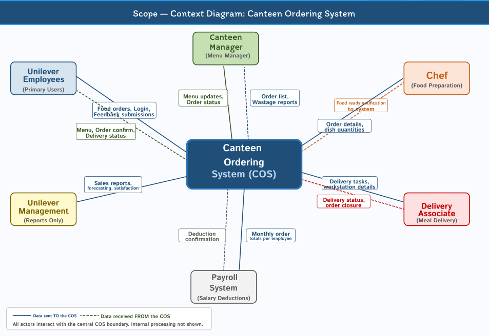
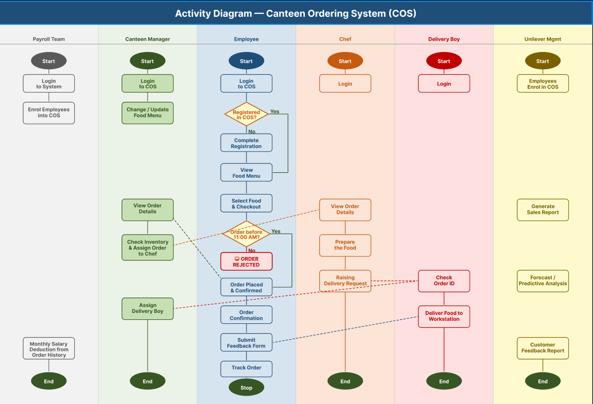
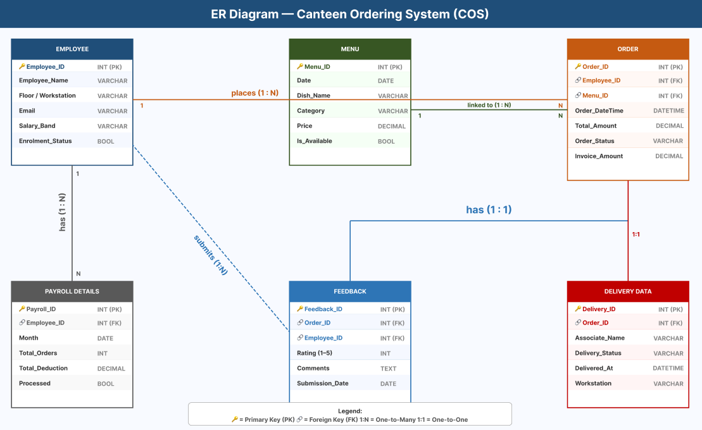
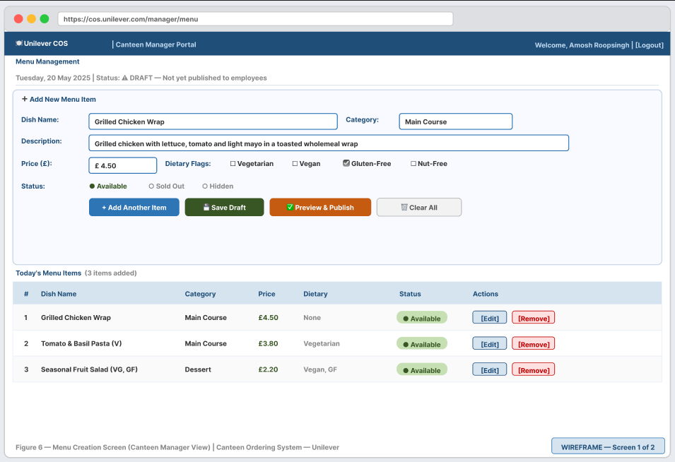
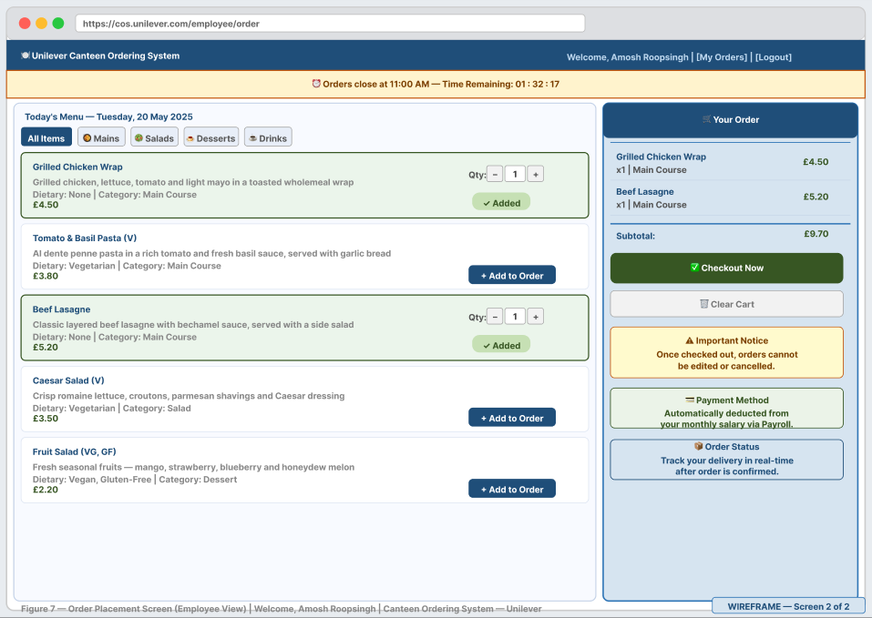

  

  
  
  
  

> **Course project** (Simplilearn CBAP programme, Course-end Project 1). This is a case study. Unilever is used as the case company. It is not a real client project and is not connected to Unilever.

## The question
How can a big office canteen know demand early, so people wait less and less food is wasted?

## The problem
- About **1,500 staff** across twelve floors, two canteens, only **300 seats**.
- Most people eat between **12 noon and 1 pm**, so long queues build up.
- The case says each employee loses **30 to 35 minutes a day** queuing and waiting.
- About **25% of the food is wasted**, because nobody knows the demand in advance.

## The solution
A web application where employees **order lunch before 11:00 am**. The order locks at checkout. The canteen manager sees the total demand, the chef prepares the food, and a delivery associate brings it to the employee's desk. At month end, payroll receives the total spend per employee.

## At a glance

| | |
|---|---|
| **Stakeholders** | 6 internal, 7 external, with a RACI matrix across 10 activities |
| **Objectives** | 4, each with a target |
| **Requirements** | 4 business, 12 functional, 7 non-functional |
| **Diagrams** | Existing process, swimlane, context, activity, ER, 2 wireframes |

## Objectives and targets

| # | Objective | Target |
|---|---|---|
| 1 | Reduce food wastage | From 25% to below 15% within 6 months |
| 2 | Reduce operating costs | 15% reduction within 12 months |
| 3 | Recover productive work time | 30 extra productive minutes per employee per day within 3 months |
| 4 | Reduce canteen headcount | Staffing reviewed at 6 and 12 months |

## How the new process works

## Diagrams

<table>
  <tr>
    <td width="50%"><b>Existing system: process flowchart</b> </td>
    <td width="50%"><b>Future state: swimlane diagram</b> </td>
  </tr>
  <tr>
    <td><b>Scope: context diagram</b> </td>
    <td><b>Activity diagram</b> </td>
  </tr>
  <tr>
    <td colspan="2"><b>ER diagram</b> </td>
  </tr>
  <tr>
    <td><b>Wireframe: menu creation (canteen manager)</b> </td>
    <td><b>Wireframe: order placement (employee)</b> </td>
  </tr>
</table>

## Requirements (examples)

| Ref | Requirement | Detail |
|---|---|---|
| BR-01 | Reduce food wastage to below 15% | Measured monthly through canteen inventory |
| FR-05 | 11:00 am order cut-off | New orders are blocked after 11:00 am, with a visible countdown timer |
| FR-06 | Order confirmation and lock | Unique order ID at checkout. No edits or cancellations after that |
| FR-07 | Order processing | Manager sees a consolidated order list by dish and assigns the chef |
| FR-11 | Payroll integration | Month-end report of each employee's spend. No payment gateway |
| NFR-01 | Performance | Supports 1,500 concurrent users in the morning ordering window, page load under 3 seconds |
| NFR-05 | Reliability | No confirmed order may be lost. Data kept for 13 months for audit |

The full list is in the Word document.

## What this shows
Stakeholder analysis, RACI, problem definition and root causes, measurable objectives, AS-IS and TO-BE process mapping, swimlane, context, activity and ER diagrams, scope definition, requirements writing and wireframing.

## Files
- [`Canteen_Ordering_System_BA_Document.docx`](Canteen_Ordering_System_BA_Document.docx): the full business analysis document
- The numbered `.png` files (01 to 07): all diagrams and wireframes

---
Amosh Roopsingh, Birmingham, UK
